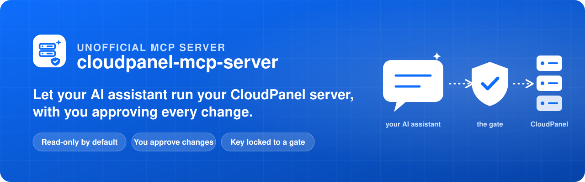
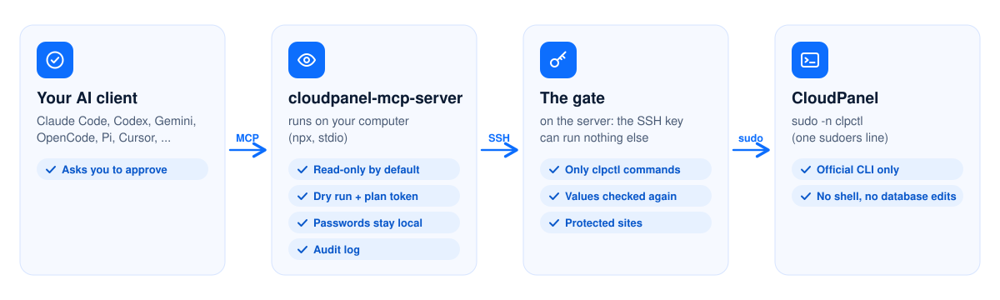

<p align="center">
  
</p>

<p align="center">
  <a href="CHANGELOG.md"></a>
  <a href="https://github.com/dasocreative/cloudpanel-mcp-server/actions/workflows/ci.yml"></a>
  <a href="https://www.cloudpanel.io"></a>
  <a href="https://modelcontextprotocol.io"></a>
  
  <a href="docs/SECURITY-MODEL.md"></a>
  <a href="LICENSE"></a>
</p>

<p align="center">
  <b>Manage your CloudPanel server by talking to your AI assistant.</b><br>
  "Create a PHP site for shop.example.com", "add a database", "install a certificate": it runs CloudPanel's own <code>clpctl</code>,<br>
  and <b>nothing changes until you approve it</b>.
</p>

<p align="center">
  <a href="#quick-start"><b>Quick start</b></a> ·
  <a href="docs/CLIENTS.md"><b>Connect your AI agent</b></a> ·
  <a href="docs/SECURITY-MODEL.md"><b>Security model</b></a> ·
  <a href="docs/TOOLS.md"><b>All 32 tools</b></a>
</p>

## What it does

<table>
  <tr>
    <td width="33%" valign="top"><br><b>Sites</b><br>Create PHP, Node.js, Python, static and reverse-proxy sites, and delete them.</td>
    <td width="33%" valign="top"><br><b>Databases</b><br>Add, export, import and delete databases and their users.</td>
    <td width="33%" valign="top"><br><b>Certificates</b><br>Let's Encrypt in one call, or install your own certificate.</td>
  </tr>
  <tr>
    <td valign="top"><br><b>Vhost templates</b><br>List, view, add, import and delete NGINX vhost templates.</td>
    <td valign="top"><br><b>Panel users</b><br>Add and delete users, reset passwords, turn off two-factor login.</td>
    <td valign="top"><br><b>Panel settings</b><br>Basic Auth, release channel, Cloudflare IPs, and what your release offers.</td>
  </tr>
</table>

Every tool is one documented `clpctl` command; the full list, with parameters, is in [docs/TOOLS.md](docs/TOOLS.md).

## Built to be safe

<table>
  <tr>
    <td width="25%" valign="top"><br><b>Read-only by default</b><br>Until you allow more, the assistant can only look.</td>
    <td width="25%" valign="top"><br><b>You approve</b><br>Each change waits for your OK in the client. To delete, you type the name.</td>
    <td width="25%" valign="top"><br><b>Key locked to a gate</b><br>The SSH key can run CloudPanel commands, nothing else. Even if it is stolen.</td>
    <td width="25%" valign="top"><br><b>Official CLI only</b><br>No shell, no raw commands, no database edits. Values are checked twice.</td>
  </tr>
  <tr>
    <td valign="top"><br><b>Protected sites</b><br>List your live sites: they can never be deleted or overwritten.</td>
    <td valign="top"><br><b>Passwords stay local</b><br>Generated on your machine, saved to a private file, never shown in the chat.</td>
    <td valign="top"><br><b>Audit log</b><br>Every call and every decision is written down, before anything runs.</td>
    <td valign="top"><br><b>Dry run first</b><br>See the exact command before it runs. Rate limits on top.</td>
  </tr>
</table>

How each layer works, and what no tool can promise: [docs/SECURITY-MODEL.md](docs/SECURITY-MODEL.md).

## How it works

<picture>
  <source media="(prefers-color-scheme: dark)" srcset="docs/assets/how-it-works-dark.svg">
  
</picture>

## Quick start

**You need:** a CloudPanel v2 server (root or sudo, once, for the setup), **Node.js 22 or newer** and `ssh` on your computer, and any MCP client.
Replace `203.0.113.10` with your server's address.

**1. Make a key for the assistant** (on your computer)

```bash
ssh-keygen -t ed25519 -f ~/.ssh/id_ed25519_cloudpanel -N "" -C ai-assistant
```

**2. Prepare the server** in one command (to read the script first: `npx -y cloudpanel-mcp-server@0.1.0 --print-server-setup | less`)

```bash
npx -y cloudpanel-mcp-server@0.1.0 --print-server-setup \
  | ssh root@203.0.113.10 "bash -s -- --key '$(cat ~/.ssh/id_ed25519_cloudpanel.pub)' --allow write"
```

It creates a dedicated account with one `sudo` rule (`clpctl` only), installs the gate, locks your key to it and tests everything. It touches no site and
no setting. Sudo user instead of root, or rather do it by hand? See [docs/SETUP.md](docs/SETUP.md).

**3. Save the connection** (on your computer)

```bash
npx -y cloudpanel-mcp-server@0.1.0 --init --host 203.0.113.10 --allow write
```

It writes the configuration and checks the connection: `ok - sudo -n /usr/bin/clpctl answered with 28 commands`. Leave out `--allow write` to start read-only.

**4. Connect your AI agent:** every client runs the same command, with no settings.

```bash
# Claude Code
claude mcp add --transport stdio --scope user cloudpanel -- npx -y cloudpanel-mcp-server@0.1.0
# Codex (then give the first start more time: docs/CLIENTS.md#codex)
codex mcp add cloudpanel -- npx -y cloudpanel-mcp-server@0.1.0
# Gemini CLI
gemini mcp add -s user cloudpanel npx -- -y cloudpanel-mcp-server@0.1.0
# OpenCode
opencode mcp add cloudpanel --global -- npx -y cloudpanel-mcp-server@0.1.0
# Pi
pi mcp add cloudpanel -- npx -y cloudpanel-mcp-server@0.1.0
# GitHub Copilot CLI
copilot mcp add cloudpanel -- npx -y cloudpanel-mcp-server@0.1.0
```

VS Code, Cursor, Claude Desktop, Windsurf, Kiro, Cline, Zed, Goose and others take one small block: [docs/CLIENTS.md](docs/CLIENTS.md).

**5. Try it:** *"Call clp_server_info and tell me what my CloudPanel server offers."*

> [!NOTE]
> Changes need a client that can show an approval form: Claude Code, Codex, OpenCode 2.x, Cursor, VS Code, Copilot CLI, Goose and Kiro. In the others
> (Gemini CLI, Pi, Claude Desktop, Windsurf, Cline, Zed, ...) the assistant can look at everything and gives you the exact command for each change.
> [Details](docs/CLIENTS.md#which-clients-can-approve-changes).

> [!TIP]
> If `npx` cannot find the package (before the first release is on npm), build it once: `git clone` this repository, `npm ci && npm run build`, and use
> `node /absolute/path/to/dist/index.js` in place of `npx -y cloudpanel-mcp-server@0.1.0`.

## Documentation

| | |
| --- | --- |
| [Setup in detail](docs/SETUP.md) | script options, sudo users, setting up by hand, the inventory helper, removing it |
| [Connect your AI agent](docs/CLIENTS.md) | every client, start timeouts, which ones can approve changes |
| [Configuration](docs/CONFIGURATION.md) | several servers, protected sites, every setting and variable |
| [Security model](docs/SECURITY-MODEL.md) | approval, the gate, layers of protection, honest limits |
| [Tools](docs/TOOLS.md) | all 32 tools and their parameters |
| [Troubleshooting](docs/TROUBLESHOOTING.md) | what an error means and how to fix it |
| [Live verification](docs/LIVE-VERIFICATION.md) · [Security review](docs/SECURITY-REVIEW.md) | what has been tested on a real CloudPanel, and the independent review |
| [Contributing](CONTRIBUTING.md) · [Report a vulnerability](SECURITY.md) · [Changelog](CHANGELOG.md) | |

## Status

Pre-release (0.1.x). Every tool family has run against a real CloudPanel 2.5.4, except the panel's Basic Auth and release-channel switches, the two
site-user commands and the inventory helper, which have run only against a strict `clpctl` simulator ([details](docs/LIVE-VERIFICATION.md)).

---

<sub><b>Unofficial.</b> This project is not affiliated with, endorsed by or sponsored by CloudPanel or its vendor. "CloudPanel" is a trademark of its owner; the
name only says what this software works with. Licensed under [Apache-2.0](LICENSE).</sub>
